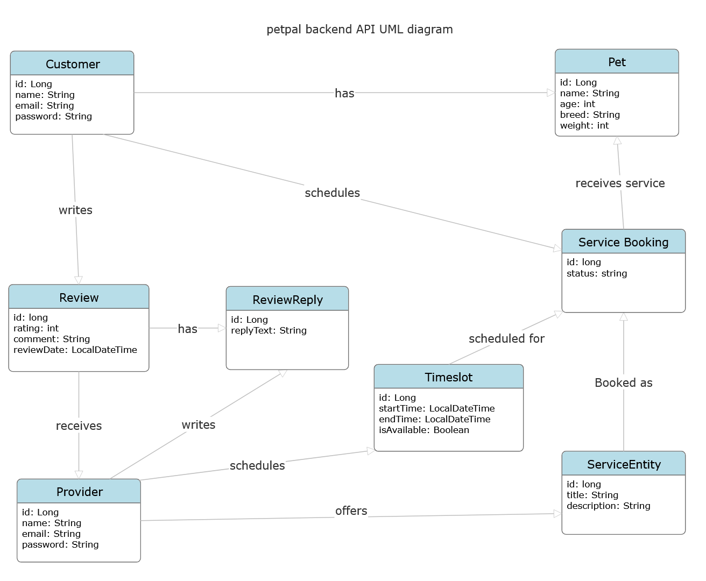

# PetPal backend API

# UML



# Customer Endpoints
| Method | Path                            | Purpose                                                    | Response code | Error codes | User story                                                              |
| ------ | ------------------------------- | ---------------------------------------------------------- | ------------- | ----------- | ----------------------------------------------------------------------- |
| `POST` | `/api/customers`                | Register a new customer.  | `201 Created` | `400, 409`  |  New customer Creation
| `PUT` | `/api/customers/{id}`                | update existing customer details.  | `201 Created` | `400, 409`  |  update customer profile
| `GET` | `/api/services`                | Browse provider services.  | `201 Created` | `400, 409`  |  Browse Services
| `POST` | `/api/customers/{id}/subscriptions`                | Subscribe to a service.  | `200 OK` | `400, 409`  |  Subscribe to Service
| `POST` | `/api/services/{serviceId}/reviews`                | Add a review to a service.  | `201 Created` | `400, 409`  |  review a service

# Provider Endpoints
| Method | Path                            | Purpose                                                    | Response code | Error codes | User story                                                              |
| ------ | ------------------------------- | ---------------------------------------------------------- | ------------- | ----------- | ----------------------------------------------------------------------- |
| `GET` | `/api/providers`                | Retrieve a list of all service providers.  | `200 OK` | `400, 409`  |  View Services
| `GET` | `/api/providers/{id}`                | Retrieve details and services of a specific provider  | `200 OK` | `400, 409`  |  View Details
| `POST` | `/api/providers`                | Register a new service provider.  | `201 Created` | `400, 409`  |  New Provider Creation
| `PUT` | `/api/providers/{id}`                | Update existing provider details.  | `200 OK` | `400, 409`  |  Update Provider Profile
| `DELETE` | `/api/providers/{id}`                | Remove a provider and their associated services  | `204 No Content` | `400, 409`  | Delete Profile
| `POST` | `/api/services`                | Add a new service offering to a provider.  | `201 Created` | `400, 409`  |  Add Service
| `PUT` | `/api/services/{id}`                | Update an existing service's details or price.  | `200 OK` | `400, 409`  |  Update Service
| `POST` | `/api/reviews/{reviewId}/replies`                | Add a reply to a specific review.  | `201 Created` | `400, 409`  |  Reply to reviews


## Example Request

### 1. Create Provider (`POST /api/providers`)
```json
{
  "name": "Elite Plumbing Services",
  "email": "contact@eliteplumbing.com",
  "category": "Home Maintenance"
} 
```
### 2. Update Provider (PUT /api/providers/{id})
``` json
{
  "name": "Elite Plumbing & HVAC",
  "email": "support@eliteplumbinghvac.com",
  "category": "Home Maintenance"
}
```
### 3. Create Service (POST /api/services)
``` JSON
{
  "title": "Emergency Pipe Repair",
  "description": "24/7 fast response for leaking or burst pipes.",
  "price": 150.00,
  "provider": {
    "id": 1
  }
}
```

### 4. Update Service (PUT /api/services/{id})
``` JSON
{
  "title": "Emergency Pipe Repair & Inspection",
  "description": "24/7 fast response including free camera line inspection.",
  "price": 175.00
}
```

### 5. Create Review Reply (POST /api/reviews/{reviewId}/replies)
``` JSON
{
  "replyText": "Thank you so much! Glad we could help get things back to normal quickly."
}
```

=======
## link to deployed api:

https://f26-team18.onrender.com/backend-api/

Note: free Render services sleep when idle, so the first request can take up to a minute. 
